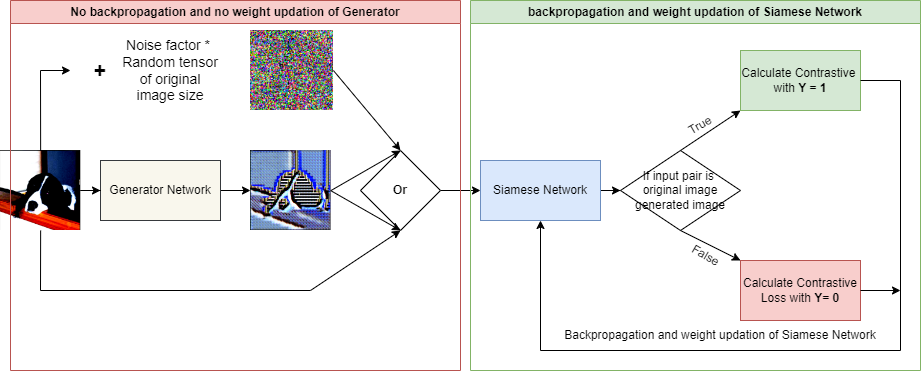
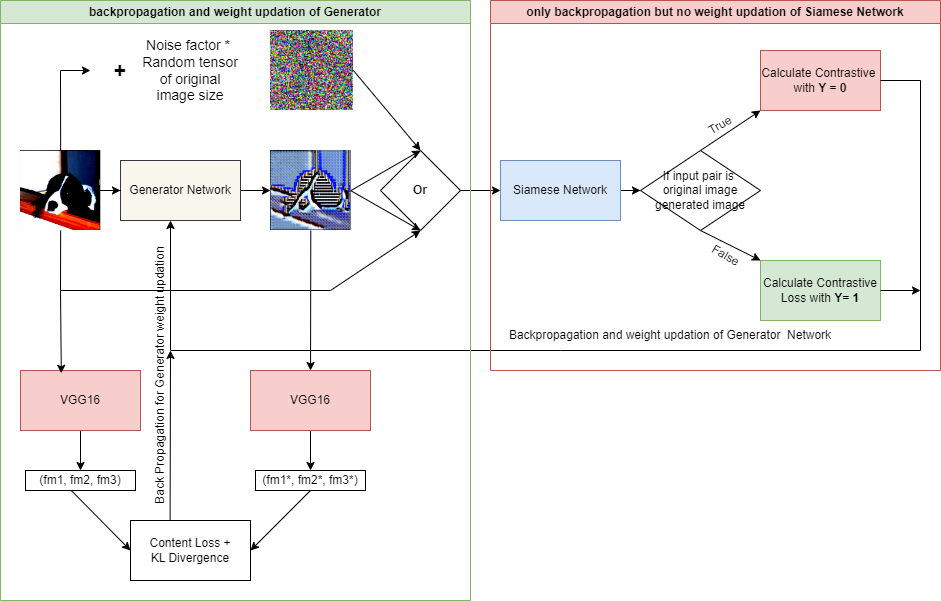

# 🔐 Federated Learning Defense via Feature-Aligned Adversarial Fake Data

This project implements a defense mechanism against **gradient inversion attacks** in **federated learning** by replacing sensitive local training data with **autoencoder-generated fake data** that are **semantically aligned** with the original data, yet **visually uninformative (noise-like)**.

We use **KL divergence-based feature alignment** across multiple layers of a pre-trained model and a **Siamese network** to ensure the generated fake data maintain the utility for model training while making gradient inversion practically infeasible.

---

## 🚀 Motivation

Federated Learning allows multiple clients to collaboratively train a deep learning model without sharing their private data. However, recent research shows that **gradient inversion attacks** can reconstruct client data from model updates.

This project proposes a **client-side defense** by generating **fake data** that:

* Do **not resemble** the actual data visually (privacy)
* Retain **semantic representation** (utility)
* Ensure the server cannot **recover original images** from gradients

---

## 🧠 Problem Setup

### Federated Learning:

* A central server initializes and shares model weights
* Clients train on local data and return updated weights
* The server performs **Federated Averaging** over client updates

### Gradient Inversion Attack:

A malicious server/attacker:

* Knows the initial shared weights and per-client updated weights
* Uses optimization to reconstruct input data that would produce similar gradients

### Our Defense:

Clients do **not use original data** for local training.

Instead:

* Train an **autoencoder** on original data
* Use it to generate **fake data**
* Use this fake data for all local training

---

## 🛡️ Proposed Method

### Step 1: Train a Baseline Classifier

* Train a deep neural network `f(x)` on the client's original data
* Save the trained weights

### Step 2: Train an Autoencoder to Generate Fake Data

* Use the encoder–decoder to produce fake samples `x_fake = AE(z)`

### Step 3: Align Features with KL Divergence

* Forward both `x_real` and `x_fake` through frozen classifier `f(x)`
* Extract features from intermediate layers
* Compute KL divergence between `f(x_real)` and `f(x_fake)` features
* Backprop through `AE` to minimize this divergence

### Step 4: Siamese Network — The Adversarial Component

The KL divergence loss encourages semantic similarity between fake and original features. However, it can also cause fake images to become **visually too close** to the real data, which undermines privacy.

To prevent this, we introduce a **Siamese network** that acts as an **adversarial regularizer**:

* Trained to recognize:

  * **(Fake, Noise)** pairs as dissimilar → pushes fake data away from noise
  * **(Fake, Real of same class)** as similar → pulls toward class-representative structure

* This forces the fake data to:

  * Appear **visually unrecognizable (like noise)**
  * But encode **semantically meaningful class features**

✅ The result is fake data that:

* Cannot be inverted via gradients
* Still train models that generalize like the original data

### Step 5: Federated Training

* Each client trains on generated fake data
* Sends gradients/weights to the server
* Server does federated averaging as usual

---

## 🔬 Training Overview

  

* Discriminator weight updation.

  

* Generate weight updation.

## 🧪 Datasets

* [x] Imagenette-320
---

## 📌 Key Contributions

* Introduced a novel **client-side fake data generator** using feature-aligned adversarial training
* Ensured **privacy without degrading model utility**
* Combined **KL-divergence loss** and **Siamese adversarial regularization** to guide data generation
* Achieved resistance to gradient inversion while maintaining test performance

---

## 📚 References

1. **Zhu, Ligeng, Liu, Zhijian, and Han, Song.**  
   [*Deep Leakage from Gradients*](https://arxiv.org/abs/1906.08935). *NeurIPS*, 2019.  
   > Foundational work demonstrating that training data can be reconstructed from shared gradients in federated learning.

2. **Zhao, Bo, Mopuri, Konda Reddy, and Bilen, Hakan.**  
   [*iDLG: Improved Deep Leakage from Gradients*](https://arxiv.org/abs/2001.02610). *arXiv*, 2020.  
   > Enhances gradient inversion attacks with deterministic and efficient reconstruction strategies.

3. **Yin, Hongxu et al.**  
   [*See Through Gradients: Image Batch Recovery via GradInversion*](https://openaccess.thecvf.com/content/CVPR2021/papers/Yin_See_Through_Gradients_Image_Batch_Recovery_via_GradInversion_CVPR_2021_paper.pdf). *CVPR*, 2021.  
   > Demonstrates batch-level gradient inversion attacks that can recover entire training batches.

4. **Huang, Yangsibo et al.**  
   [*Evaluating Gradient Inversion Attacks and Defenses in Federated Learning*](https://arxiv.org/abs/2112.05158). *NeurIPS*, 2021.  
   > Provides a taxonomy and benchmarking framework for attacks and defense techniques in FL.

5. **Ovi, Pretom Roy et al.**  
   *Mixed Precision Quantization to Tackle Gradient Leakage Attacks in Federated Learning*. *CVPR*, 2022.  
   > Introduces mixed-precision quantization as a defense to limit the fidelity of gradient-based data reconstruction.

6. **Lu, Guangxi et al.**  
   *Defeat: A Decentralized Federated Learning Against Gradient Attacks*. *High-Confidence Computing*, 2023.  
   > Presents a decentralized learning approach to mitigate gradient-based privacy threats.

7. **Wen, Jing et al.**  
   *Defending Against Model Inversion Attack by Adversarial Examples*. *IEEE Conference on Cyber Security and Resilience*, 2021.  
   > Adopts adversarial training principles to resist model inversion — aligns conceptually with Siamese regularization.

8. **Koch, Gregory, Zemel, Richard, and Salakhutdinov, Ruslan.**  
   *Siamese Neural Networks for One-Shot Image Recognition*. *ICML Deep Learning Workshop*, 2015.  
   > Lays the foundation for contrastive learning methods, forming the basis of the adversarial Siamese loss used in this work.

---
